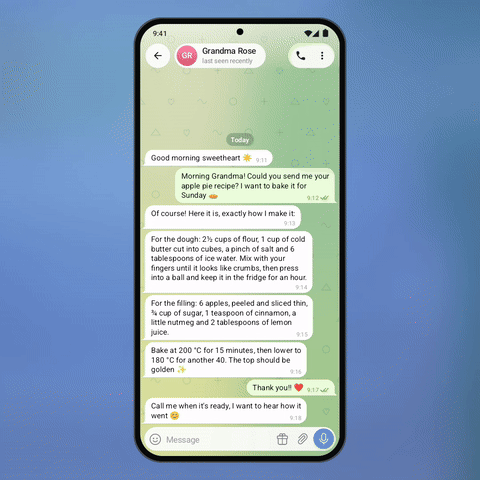

# 🔍 Pinch Text Zoom

Pinch the message list to make text bigger or smaller **in this chat only**. The message under
your fingers stays in place, a small "Aa 140%" pill shows the size, and it snaps to 100% with a
haptic tick. Grandma's recipe in big letters, the work chat stays compact.

<p align="center"></p>

<p align="center"><b>&#9654;&#65039; <a href="demo.mp4">Full-quality video (demo.mp4)</a></b> &middot; Telegram for Android 12.4 design &middot; Android 8+</p>

## How it works

- `ChatTextScaleController` wraps `ScaleGestureDetector`, clamps to 80–180%, snaps near 100%
  and saves the value per dialog.
- While two fingers are down the list does not scroll; children get `ACTION_CANCEL`.
- The demo keeps the message under the focus point anchored after relayout.

## Integration into Telegram for Android

| Where | What |
|---|---|
| `ChatActivity` → `chatListView.dispatchTouchEvent` | feed events to `onTouchEvent` first; if it returns true, consume |
| `MessageObject.generateLayout` | use a per-dialog font size override instead of `SharedConfig.fontSize` |
| `Listener.onScale` | `MessageObject.forceUpdate`, `chatAdapter.notifyDataSetChanged`, keep the anchor with `chatLayoutManager.scrollToPositionWithOffset` |
| Chat settings | "Reset text size" for the chat, next to wallpaper |

Files: [`ChatTextScaleController.java`](pinch-zoom/src/main/java/org/telegram/ui/Components/ChatTextScaleController.java).

## Build and run

Requirements: JDK 17 and the Android SDK (platform 36). Point Gradle at the SDK with
`local.properties` (`sdk.dir=/path/to/Android/sdk`) or `ANDROID_HOME`.

```
./gradlew :pinch-zoom:assembleDebug
adb install pinch-zoom/build/outputs/apk/debug/pinch-zoom-debug.apk
```

The app opens on the demo screen and works by hand. For the presentation look of the video:

```
adb shell am start -n org.telegram.lab.pinchzoom/.MainActivity --ez stage true --ez autoplay true
```

## Project layout

| Path | What it is |
|---|---|
| `pinch-zoom/src/main/java/org/telegram/ui/Components/` | **the feature itself**, drop-in for Telegram's `TMessagesProj` (Android SDK + `AndroidUtilities` only) |
| `pinch-zoom/src/main/java/org/telegram/lab/pinchzoom/` | the demo screen and the scripted demo used for the video |
| `core/` | Telegram 12.4-style UI the demo is built on: chat screen, bubbles, composer, sheets, menus, Telegram's own icons |

## License

GPL-2.0, same as Telegram for Android, whose icons are included in `core`.